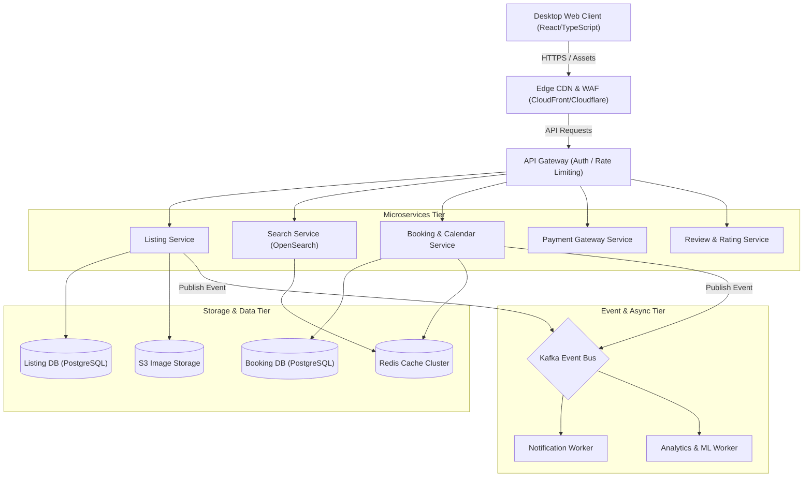

# UI Architecture Plan

## 1. Recommended Stack

- **Framework**: **React 18 / 19 + Vite + TypeScript**
- **Evaluation of Options**:
  - **React + Vite (Recommended)**: Offers near-instant Hot Module Replacement (HMR), zero-config TypeScript compilation, minimal bundle overhead, and complete control over client-side DOM rendering, keyboard focus trapping, modal dialogs, and URL search param synchronization without SSR hydration mismatches.
  - **Next.js (App Router)**: Excellent for SEO and server-driven sites, but introduces unnecessary SSR hydration overhead for heavy client-side modal state, portal focus management, and static take-home deployment.
  - **Angular**: Introduces excessive boilerplate (modules, decorators, dependency injection) that slows down rapid visual tweaking and desktop-only take-home iteration.
- **Decision Rationale**: A client-side React + Vite architecture maximizes visual iteration velocity, gives fine-grained control over accessibility primitives, simplifies local development (`npm run dev`), and deploys effortlessly to Vercel/Netlify as a static build.

---

## 2. Architecture Overview

The take-home implementation is structured as an accessible, component-driven client-side application without unnecessary backend dependencies.

```
┌────────────────────────────────────────────────────────┐
│                      index.html                        │
└───────────────────────────┬────────────────────────────┘
                            │
┌───────────────────────────▼────────────────────────────┐
│                    App.tsx (Root)                      │
│   - URL Search Params Sync (?modal, ?modalItem)        │
│   - Global Keyboard Listener (Escape, Focus Tracker)   │
│   - Scroll Listener for Floating Subheader             │
└───────┬────────────────────────┬───────────────────────┘
        │                        │
┌───────▼──────────────┐ ┌───────▼───────────────────────┐
│     ListingPage      │ │    Modal Portals (<dialog>)   │
│  - GlobalHeader      │ │  - PhotoTourModal (43 photos) │
│  - StickySubHeader   │ │  - LightboxModal (Arrows/Esc) │
│  - ListingHeader     │ │  - AmenitiesModal (50 items)  │
│  - HeroGallery (5)   │ └───────────────────────────────┘
│  - 2-Col Main Grid   │
│    ├─ Left Content   │
│    └─ Sticky Aside   │
│  - ReviewsSection    │
│  - LocationMap       │
│  - HostProfile       │
│  - ThingsToKnow      │
│  - NearbyCarousel    │
└──────────────────────┘
```

---

## 3. Project Structure

```
airbnb-clone-app/
├── public/
│   ├── favicon.ico
│   └── assets/
│       ├── fonts/
│       │   └── AirbnbCerealVF.woff2
│       └── images/
│           ├── listing/ (43 categorized property photos)
│           ├── host/ (Host & Co-host avatars)
│           ├── avatars/ (Reviewer avatars)
│           └── nearby/ (8 nearby stay cards)
├── src/
│   ├── main.tsx             # Application bootstrap & StrictMode mount
│   ├── App.tsx              # Root controller (state & modal orchestrator)
│   ├── index.css            # Global tokens, resets, typography & focus styles
│   ├── types/
│   │   ├── listing.ts       # Listing, host, review, amenity data interfaces
│   │   └── gallery.ts       # Photo item, category, modal state types
│   ├── data/
│   │   ├── listingData.ts   # Property details, rules, highlights, beds
│   │   ├── galleryData.ts   # 43 photo definitions with category mappings
│   │   ├── amenitiesData.ts # 50 categorized amenities data
│   │   ├── reviewsData.ts   # Overall scores & 6 guest review records
│   │   └── nearbyData.ts    # 8 nearby stays with pricing & ratings
│   ├── hooks/
│   │   ├── useScrollSpy.ts  # Detects scroll position for sticky subheader
│   │   ├── useModalParam.ts # Two-way binding between URL params and modal state
│   │   └── useFocusTrap.ts  # Accessible focus trapping and restoration
│   ├── components/
│   │   ├── layout/
│   │   │   ├── GlobalHeader.tsx
│   │   │   ├── StickySubHeader.tsx
│   │   │   └── SkipLink.tsx
│   │   ├── gallery/
│   │   │   ├── HeroGallery.tsx
│   │   │   ├── PhotoTourModal.tsx
│   │   │   └── LightboxModal.tsx
│   │   ├── listing/
│   │   │   ├── ListingHeader.tsx
│   │   │   ├── PropertyOverview.tsx
│   │   │   ├── HighlightsList.tsx
│   │   │   ├── PropertyDescription.tsx
│   │   │   ├── SleepingArrangements.tsx
│   │   │   ├── AmenitiesPreview.tsx
│   │   │   ├── AmenitiesModal.tsx
│   │   │   └── CalendarWidget.tsx
│   │   ├── reservation/
│   │   │   └── ReservationCard.tsx
│   │   ├── reviews/
│   │   │   ├── ReviewsSummary.tsx
│   │   │   ├── ReviewRatingBars.tsx
│   │   │   └── ReviewCardGrid.tsx
│   │   ├── location/
│   │   │   └── LocationMapSection.tsx
│   │   ├── host/
│   │   │   └── HostProfileSection.tsx
│   │   ├── footer/
│   │   │   ├── ThingsToKnow.tsx
│   │   │   └── NearbyStaysCarousel.tsx
│   │   └── common/
│   │       ├── Icons.tsx     # Clean inline SVG icon definitions
│   │       └── Modal.tsx     # Generic accessible dialog wrapper
│   └── utils/
│       ├── formatters.ts    # Currency (₹), date, and count formatters
│       └── keyboard.ts      # Key constants and event helpers
├── docs/
│   ├── REFERENCE_ANALYSIS.md
│   ├── ARCHITECTURE_PLAN.md
│   └── PROMPTS.md
├── package.json
├── tsconfig.json
└── vite.config.ts
```

---

## 4. Component Hierarchy

### Component Specifications

1. **`GlobalHeader`**:
   - *Responsibility*: Renders top branding logo, search bar ("Anywhere | Anytime | Add guests"), and user navigation controls.
   - *Props*: None (stateless layout component).
   - *A11y*: `<header>`, `<nav>`, `<button aria-label="...">`.

2. **`StickySubHeader`**:
   - *Responsibility*: Smoothly slides down when user scrolls past hero gallery (`scrollY > 600px`). Shows section navigation tabs (Photos, Amenities, Reviews, Location) and right-aligned quick price summary + Reserve CTA.
   - *Props*: `isVisible: boolean`, `onReserveClick: () => void`.
   - *A11y*: `<nav aria-label="Section navigation">`, anchor links with `#id` targets.

3. **`HeroGallery`**:
   - *Responsibility*: 5-photo asymmetrical grid with hover scrims, click triggers for Lightbox, and "Show all photos" button for Photo Tour.
   - *Props*: `photos: PhotoItem[]`, `onOpenPhotoTour: () => void`, `onOpenLightbox: (index: number) => void`.
   - *A11y*: `<section aria-label="Photos of this place">`, `<button aria-label="Photo X">`.

4. **`ReservationCard`**:
   - *Responsibility*: Sticky booking widget in right column with calculated price breakdown, check-in/out dates, guest selector, and Reserve gradient button.
   - *Props*: `pricePerNight: number`, `nights: number`, `checkIn: string`, `checkOut: string`.
   - *A11y*: `<aside>`, distinct `<button>` triggers.

5. **`PhotoTourModal`**:
   - *Responsibility*: Fullscreen scrollable dialog with top header, category pills (9 groups), and 43 photos rendered with captions.
   - *Props*: `isOpen: boolean`, `onClose: () => void`, `onSelectPhoto: (index: number) => void`.
   - *A11y*: `role="dialog"`, `aria-modal="true"`, focus trap on open, focus restoration on close.

6. **`LightboxModal`**:
   - *Responsibility*: Fullscreen single-photo modal with category title, "X of 43" counter, previous/next buttons, and cross-fade image rendering.
   - *Props*: `isOpen: boolean`, `currentIndex: number`, `onClose: () => void`, `onNext: () => void`, `onPrev: () => void`.
   - *A11y*: `ArrowLeft`/`ArrowRight` key listeners, `Escape` key close, boundary disablement.

7. **`AmenitiesModal`**:
   - *Responsibility*: Centered scrollable dialog displaying 50 amenities sorted into 11 categories.
   - *Props*: `isOpen: boolean`, `onClose: () => void`.
   - *A11y*: Focus trap, `Escape` key support.

---

## 5. State Management

The application state is minimal, deterministic, and leverages standard React hooks (`useState`, `useCallback`, `useEffect`) without heavy global store abstractions.

```typescript
// Shared Application State Shape
interface ApplicationState {
  // Modal Controller
  activeModal: 'NONE' | 'PHOTO_TOUR' | 'LIGHTBOX' | 'AMENITIES';
  activePhotoIndex: number; // 0 .. 42
  
  // User Actions
  isSaved: boolean;               // Wishlist toggle
  isDescriptionExpanded: boolean; // Description clamp toggle
  
  // Sticky Header Detection
  isStickyNavVisible: boolean;
}
```

### State Placement Strategy
- **Modal & Photo Index**: Lifted to `App.tsx` because `HeroGallery`, `StickySubHeader`, `PhotoTourModal`, and `LightboxModal` all interact with modal triggers and URL params.
- **Scroll Position**: Managed via custom `useScrollSpy` hook in `App.tsx` to toggle `isStickyNavVisible`.
- **Local Toggles**: Description expansion (`isDescriptionExpanded`) and modal category scroll tabs remain local to their respective components.

---

## 6. URL and Modal State

The application synchronizes modal state with browser URL query parameters using the standard HTML5 History API (`window.history.pushState` / `replaceState` or URL search params):

1. **Photo Tour Open**: URL updates to `?modal=PHOTO_TOUR_SCROLLABLE`.
2. **Lightbox Open**: URL updates to `?modal=PHOTO_TOUR_SCROLLABLE&modalItem=INDEX`.
3. **Closing Lightbox (via Back or Escape)**: URL reverts to `?modal=PHOTO_TOUR_SCROLLABLE` if opened from Photo Tour, or clears params if opened directly from hero gallery.
4. **Closing Photo Tour (via Back or Escape)**: Clears query parameters and returns to base URL `/`.
5. **PopState Handling**: Listening to `window.onpopstate` ensures browser Back and Forward buttons seamlessly open and close modals.

---

## 7. Gallery Architecture

A single normalized array of photo objects is shared across `HeroGallery`, `PhotoTourModal`, and `LightboxModal`:

```typescript
export interface PhotoItem {
  id: number;           // 1000 .. 1042
  index: number;        // 0 .. 42
  src: string;          // Local asset path
  alt: string;          // Accessible description
  category: PhotoCategory;
  caption?: string;
  isHero: boolean;      // True for first 5 images
  heroPosition?: 1 | 2 | 3 | 4 | 5;
}

export type PhotoCategory =
  | 'Living room 1'
  | 'Living room 2'
  | 'Full kitchen'
  | 'Bedroom'
  | 'Full bathroom'
  | 'Gym'
  | 'Exterior'
  | 'Pool'
  | 'Additional photos';
```

### Sharing Without Duplication
- `galleryData.ts` exports `ALL_PHOTOS: PhotoItem[]`.
- `HERO_PHOTOS = ALL_PHOTOS.slice(0, 5)`.
- `CATEGORIZED_PHOTOS = groupBy(ALL_PHOTOS, 'category')`.
- `LightboxModal` receives the absolute `currentIndex` and accesses `ALL_PHOTOS[currentIndex]` in $O(1)$ time.

---

## 8. Accessibility Architecture

- **Semantic HTML**: `<main id="main">`, `<header>`, `<nav>`, `<section>`, `<aside>`, `<dialog>`, and heading tags `<h1>` through `<h3>`.
- **Skip Navigation**: `<a href="#main" className="skip-link">Skip to content</a>` positioned off-screen and visible on `:focus`.
- **Keyboard Traps & Restoration**:
  - `useFocusTrap` captures active focus within modal dialogs (`Tab` and `Shift+Tab` loop).
  - Remembers `document.activeElement` before modal open and calls `.focus()` on it when the modal closes.
- **Keyboard Shortcuts**:
  - `Escape`: Closes open modal (Lightbox → Photo Tour → Page).
  - `ArrowLeft` / `ArrowRight`: Steps through Lightbox photos.
- **Visible Focus Rings**: `body.kbd :focus-visible` defines crisp 2px solid `#222` outline with 2px offset.
- **Scroll Lock**: Adds `overflow: hidden` to `document.body` whenever a modal is active.

---

## 9. Styling Strategy

- **Recommendation**: **Vanilla CSS + CSS Modules / Scoped Token Architecture**.
- **Rationale**:
  - Complete fidelity with the reference CSS custom properties (`--ink`, `--rausch`, `--reserve`, `--container`, `--line-soft`).
  - No CSS build friction or tailwind config mismatches.
  - Granular control over CSS Grid fractions (`35fr 17fr 17fr`), aspect ratios (`1120 / 494`), cubic-bezier transition curves, and media queries.
- **Tokens Structure (`src/index.css`)**:
  ```css
  :root {
    --ink: #222222;
    --muted: #6a6a6a;
    --muted2: #717171;
    --line: #dddddd;
    --line-soft: #ebebeb;
    --card-border: rgba(0, 0, 0, 0.08);
    --rausch: #ff385c;
    --reserve: linear-gradient(to right, #e61e4d 0%, #e31c5f 50%, #d70466 100%);
    --reserve-hover: linear-gradient(to right, #d81b5f 0%, #c31a5b 50%, #bd0463 100%);
    --grey100: #f7f7f7;
    --grey200: #f2f2f2;
    --grey300: #ebebeb;
    --container: 1280px;
    --font: "Airbnb Cereal VF", Circular, -apple-system, BlinkMacSystemFont, "system-ui", Roboto, "Helvetica Neue", sans-serif;
    --shadow-card: 0 6px 16px rgba(0, 0, 0, 0.12);
    --shadow-hover: 0 2px 4px rgba(0, 0, 0, 0.18);
  }
  ```

---

## 10. Animation Strategy

- **Sticky Header**: `transform: translateY(-100%)` → `translateY(0)` with `opacity: 0` → `1` over `0.25s ease`.
- **Modal Opening**: `transform: translateY(28px)` → `translateY(0)` with `opacity: 0` → `1` over `0.3s cubic-bezier(0.2, 0, 0, 1)`.
- **Lightbox Fade**: CSS keyframe `animation: lbFade 0.3s ease` on image element.
- **Image Hover**: `transform: scale(1.04)` with dark pseudo scrim over `0.25s cubic-bezier(0.2, 0, 0, 1)`.
- **Button Click Feedback**: Active transform `transform: scale(0.96)` for immediate tactile feel.
- **Accessibility**: `@media (prefers-reduced-motion: reduce)` collapses transition durations to `1ms`.

---

## 11. Asset Strategy

- **Location**: Static images stored locally under `public/assets/images/` and fonts under `public/assets/fonts/`.
- **Naming Convention**: `photo-01-hero.jpg` .. `photo-43-additional.jpg`, `avatar-host.jpg`, `avatar-user-1.jpg`.
- **Loading Strategy**:
  - First 5 hero images loaded eagerly (`loading="eager"`).
  - Photo Tour and Lightbox images loaded with native lazy loading (`loading="lazy"`) and asynchronous decoding (`decoding="async"`).
- **Originality Rule**: All static assets are referenced via clean local mock metadata definitions without copying proprietary bundling scripts.

---

## 12. Testing Strategy

### 1. Functional QA
- Verify clicking hero images (1–5) opens Lightbox at matching index.
- Verify clicking "Show all photos" opens Photo Tour.
- Verify clicking photos in Photo Tour opens Lightbox at correct index.
- Verify Previous/Next buttons increment/decrement index and disable at boundaries (index 0 and 42).
- Verify sticky subheader appears past 600px scroll and anchors jump smoothly to sections.
- Verify Amenities modal displays all 50 items across 11 groups.

### 2. Accessibility QA
- Full keyboard-only navigation run-through using `Tab`, `Shift+Tab`, `Enter`, `Space`, `ArrowLeft`, `ArrowRight`, and `Escape`.
- Verify focus trap in open dialogs and focus restoration to trigger buttons on close.
- Verify screen reader attributes (`aria-label`, `aria-modal`, `role="dialog"`).

### 3. Visual Regression QA
- Test at `1440px`, `1280px`, and `1128px` desktop viewports.
- Compare layout alignment, typography weights, color tokens, and border radii against `docs/REFERENCE_ANALYSIS.md`.

---

## 13. Performance Considerations

1. **Lightweight Core**: Standard React with zero heavy UI libraries ensures bundle size stays under ~120KB gzipped.
2. **Virtual / Efficient Gallery Rendering**: 43 image cards in Photo Tour use native `content-visibility: auto` and `loading="lazy"` to prevent main-thread layout thrashing.
3. **Passive Scroll Listeners**: Scroll handlers for sticky headers use passive event listeners and `requestAnimationFrame` debouncing.
4. **Memoized Handlers**: Key callbacks (`onNext`, `onPrev`, `onClose`) are wrapped in `useCallback` to prevent unnecessary component re-renders.

---

## 14. Implementation Sequence

| Phase | Objective | Key Files / Deliverables | Completion Criteria |
|---|---|---|---|
| **Phase 1** | Project Bootstrap & Design Tokens | `package.json`, `index.css`, `types/`, assets folder setup | Vite dev server runs, CSS tokens & font loaded |
| **Phase 2** | Mock Data Layer | `src/data/*.ts` (all 43 photos, 50 amenities, reviews) | Typed data structures ready for consumption |
| **Phase 3** | Shell & Global Navigation | `GlobalHeader.tsx`, `StickySubHeader.tsx`, `SkipLink.tsx` | Header renders, sticky subheader toggles on scroll |
| **Phase 4** | Listing Header & Hero Gallery | `ListingHeader.tsx`, `HeroGallery.tsx` | 5-photo grid renders with exact aspect ratio & hover dimming |
| **Phase 5** | Left Content Column | `PropertyOverview.tsx`, `HighlightsList.tsx`, `PropertyDescription.tsx`, `SleepingArrangements.tsx`, `AmenitiesPreview.tsx`, `CalendarWidget.tsx` | All listing details, bed cards, amenities preview render cleanly |
| **Phase 6** | Sticky Reservation Card | `ReservationCard.tsx` | Sticky pricing card adheres to right column at `top: 100px` |
| **Phase 7** | Secondary Listing Sections | `ReviewsSection.tsx`, `LocationMapSection.tsx`, `HostProfileSection.tsx`, `ThingsToKnow.tsx`, `NearbyStaysCarousel.tsx` | Rating score bars, host superhost card, nearby carousel render |
| **Phase 8** | Photo Tour Modal | `PhotoTourModal.tsx` | Fullscreen dialog with 9 category navigation tabs & 43 photos |
| **Phase 9** | Lightbox Single-Photo Modal | `LightboxModal.tsx` | Fullscreen photo viewer with keyboard arrow navigation & counter |
| **Phase 10** | Amenities Full Modal | `AmenitiesModal.tsx` | 50 amenities grouped into 11 categories in scrollable modal |
| **Phase 11** | Accessibility & Focus Traps | `useFocusTrap.ts`, `useModalParam.ts`, `Escape` handling | Keyboard-only navigation & focus restoration verified |
| **Phase 12** | Visual QA & Polish | CSS fine-tuning, transitions, cross-browser validation | Matches reference analysis specification |

---

## 15. Production-Scale Marketplace Architecture

To demonstrate production engineering thinking for a full-scale vacation-rental marketplace (e.g., Airbnb), the following high-level system architecture is designed:

```
                                    ┌───────────────────────┐
                                    │    Global DNS / CDN   │ (Cloudflare / CloudFront)
                                    │  - Static Asset Edge  │
                                    │  - DDoS / WAF Shield  │
                                    └───────────┬───────────┘
                                                │
                                    ┌───────────▼───────────┐
                                    │   API Gateway / Envoy │ (Rate limiting, Auth, Routing)
                                    └───────────┬───────────┘
                                                │
         ┌──────────────────┬───────────────────┼───────────────────┬───────────────────┐
         │                  │                   │                   │                   │
┌────────▼────────┐ ┌───────▼─────────┐ ┌───────▼─────────┐ ┌───────▼─────────┐ ┌───────▼─────────┐
│ Listing Service │ │ Booking Service │ │ Payment Service │ │  Search Service │ │  Review Service │
│ (gRPC / Node/Go)│ │ (Saga Workflow) │ │ (PCI-DSS Vault) │ │ (OpenSearch/ES) │ │ (Aggregations)  │
└────────┬────────┘ └───────┬─────────┘ └───────┬─────────┘ └───────┬─────────┘ └───────┬─────────┘
         │                  │                   │                   │                   │
┌────────▼────────┐ ┌───────▼─────────┐ ┌───────▼─────────┐ ┌───────▼─────────┐ ┌───────▼─────────┐
│  PostgreSQL DB  │ │  PostgreSQL DB  │ │   Stripe / Bank │ │ Elastic Cluster │ │  PostgreSQL DB  │
│ (Primary/Replica│ │ (Locks/Dates)   │ │     Gateway     │ │ (Geo/Facet Index│ │ (Read Replicas) │
└────────┬────────┘ └───────┬─────────┘ └─────────────────┘ └─────────────────┘ └─────────────────┘
         │                  │
         └─────────┬────────┘
                   │
        ┌──────────▼──────────┐
        │  Kafka Event Bus    │ (Async Events: ListingUpdated, BookingConfirmed, PaymentCaptured)
        └──────────┬──────────┘
                   │
    ┌──────────────┴──────────────┐
    │                             │
┌───▼─────────────────────┐ ┌─────▼─────────────────────┐
│ Notification Service    │ │ Analytics / ML Service    │
│ (Email, SMS, Push)      │ │ (Pricing Engine, Fraud)   │
└─────────────────────────┘ └───────────────────────────┘
```

### Production Components:
1. **Frontend Delivery**: Distributed Edge CDN caching static Next.js/React assets and responsive image pipelines (WebP/AVIF transformations on-the-fly).
2. **API Gateway**: Envoy/Kong handling TLS termination, JWT verification, rate limiting, and request routing.
3. **Core Microservices**:
   - **Listing Service**: Manages property metadata, room layouts, amenity definitions, and host ownership.
   - **Search Service**: Elasticsearch/OpenSearch powering geo-spatial radius queries, facet filtering, date availability scoring, and real-time ranking.
   - **Booking Service**: Manages reservation state machines with distributed locks (Redis Redlock) and Saga orchestration for concurrency control on dates.
   - **Payment Service**: Tokenized payment processing via Stripe/banking partners with double-entry ledger bookkeeping.
4. **Data Tier & Caching**:
   - Primary Relational Databases (PostgreSQL with Aurora multi-AZ replication).
   - Distributed Caching (Redis Cluster for session store, rate limits, and listing cache).
   - Object Storage (AWS S3 / Google Cloud Storage with presigned upload URLs for host photos).
5. **Event-Driven Backbone**: Apache Kafka streaming events (`BookingRequested`, `ListingPublished`, `ReviewAdded`) to decouple notification, indexing, and analytics pipelines.

---

## 16. Architecture Diagram Specification

*(Ready for visual synthesis in Lucidchart, Excalidraw, or Markdown Mermaid)*



---

## 17. Architectural Trade-offs

| Decision | Chosen Option | Alternative Considered | Rationale & Trade-off |
|---|---|---|---|
| **Framework** | React 18 + Vite | Next.js App Router | Vite eliminates SSR hydration friction and maximizes local visual iteration speed for a desktop listing take-home task. |
| **Styling** | Vanilla CSS + CSS Variables | Tailwind CSS | Direct custom property mapping (`--rausch`, `--reserve`, `--container`) guarantees 100% fidelity without utility config overhead. |
| **State Scope** | Component State + React Hooks | Redux / Zustand | The listing page interactions (modals, active photo, sticky subheader) are cleanly handled with zero third-party store dependencies. |
| **Data Source** | Local Typed Mock Modules | Mock REST/GraphQL Server | Standalone static data avoids async network latency during visual evaluation and simplifies static bundle deployment. |
| **Dialog Implementation** | Native HTML `<dialog>` + Portals | Headless UI / Radix | Direct DOM dialog element provides native accessibility primitives, backdrop layering, and zero bundle footprint. |

---

## 18. Risks and Mitigations

1. **Risk**: Modal scroll bleed (background page scrolls while Photo Tour is open).
   - *Mitigation*: Centralized `useModalParam` hook dynamically toggles `overflow: hidden` on `document.body`.
2. **Risk**: Focus loss when closing Lightbox or Photo Tour.
   - *Mitigation*: `useFocusTrap` captures the active triggering element before modal mount and explicitly restores focus upon unmount.
3. **Risk**: Image loading delay on large 43-photo gallery.
   - *Mitigation*: Eager load 5 hero images, lazy load remaining 38 images with `content-visibility: auto`.
4. **Risk**: Reservation card layout jump on sticky transition.
   - *Mitigation*: Fixed sidebar column width (`372px`) inside a CSS Grid container prevents reflow during sticky affixing.

---

## 19. Definition of Done

- [ ] Complete desktop-only layout matching 1280px max container and 80px page gutters.
- [ ] Global header and sticky secondary anchor subheader functional on scroll.
- [ ] 5-photo hero gallery with correct grid proportions (`35fr 17fr 17fr`) and hover effects.
- [ ] Sticky reservation sidebar tracks viewport accurately.
- [ ] Photo Tour modal renders 43 photos categorized into 9 groups with sticky navigation.
- [ ] Lightbox single-photo viewer supports previous/next buttons, boundary checks, and `ArrowLeft`/`ArrowRight`/`Escape` keys.
- [ ] Amenities modal displays all 50 categorized items with close triggers.
- [ ] Full keyboard accessibility with visible 2px focus indicators and focus restoration.
- [ ] Production marketplace architecture and Excalidraw-ready diagram documented in `docs/ARCHITECTURE_PLAN.md`.
